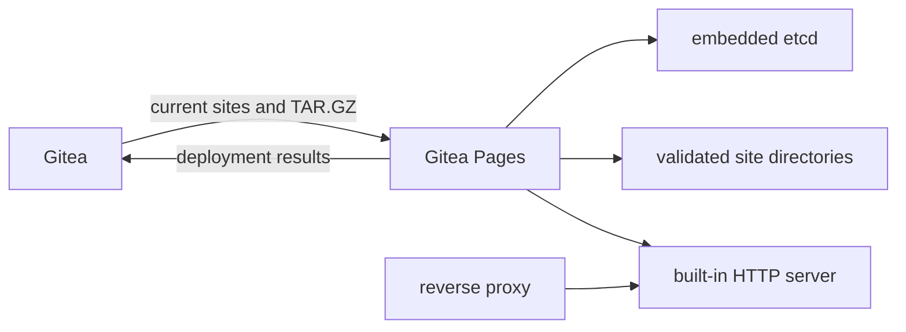

# Gitea Pages

Gitea Pages is the website-serving companion for Gitea. It synchronizes the current Pages state from Gitea, validates and extracts each TAR.GZ artifact, publishes the result through a built-in HTTP server, and reports the outcome for display in the repository UI.

The service is also available as the Go module `gitea.dev/page`. Applications with an existing web stack can implement the public `Publisher` interface and reuse the same synchronization, archive validation, local state, and reporting pipeline.

## Features

- Active deployment of the current artifact without work on visitor requests.
- Default owner and project addresses compatible with the GitHub Pages layout.
- Custom domains with independent Gitea and local TXT ownership checks.
- Built-in HTTP serving, optional native HTTPS, and reverse-proxy operation.
- ACME through [`go-acme/lego`](https://github.com/go-acme/lego): DNS-01 for the default Pages domain and HTTP-01 for custom domains.
- Operator-provided certificates and durable ACME certificates stored in embedded etcd.
- Strict TAR.GZ path, type, size, entry-count, and symbolic-link validation.
- Bounded deployment queues, incremental synchronization, and durable result delivery.
- Custom platform home page, 404 page, and assets.

## How it works



Gitea owns repository settings, artifact versions, artifact storage, and the instance registry. Each Pages process owns one local deployment of every enabled site returned by Gitea. It keeps the last confirmed deployment available while synchronization is temporarily unavailable.

## Requirements

- Go 1.27 or later when building from source.
- A Gitea instance with Pages support and an instance token created by a global administrator.
- A persistent local directory for embedded etcd and extracted site content.
- DNS and certificate automation credentials when Pages manages HTTPS.

## Build and run

```sh
make build
./bin/gitea-pages --config /etc/gitea-pages/config.yaml
```

The process handles `SIGINT` and `SIGTERM` with graceful HTTP and synchronization shutdown. Keep the configured data directory on persistent local storage and run one process against that directory.

## Configuration

The command reads one YAML file passed with `--config`. Parsing is strict: field names are checked and the file must contain exactly one YAML document. The following example runs an HTTP origin behind a reverse proxy while registering an HTTPS public address with Gitea:

```yaml
gitea:
  url: https://gitea.example.com
  token: replace-with-the-instance-token

pages:
  root_url: https://pages.example.com
  data_root: /var/lib/gitea-pages
  custom_root: /etc/gitea-pages/public

server:
  http_listen: 127.0.0.1:3000
  https:
    mode: proxy

sync:
  interval: 1m
  deploy_timeout: 10m
  queue_size: 32
  concurrency: 2

storage:
  etcd_quota_bytes: 2147483648

domains:
  resolver: 1.1.1.1
  refresh_interval: 15m
```

### HTTPS ownership

`server.https.mode` states which component owns the public HTTPS connection:

| Mode | Public root URL | Local listeners | Certificate behavior |
| --- | --- | --- | --- |
| `disabled` | `http://…` | `server.http_listen` | Serves plain HTTP. |
| `proxy` | `https://…` | `server.http_listen` | Serves plain HTTP to a reverse proxy. Pages confirms deployments through the local HTTP listener. |
| `pages` | `https://…` | HTTP and HTTPS listeners | Pages terminates TLS, serves HTTP-01, manages certificates, and redirects known HTTP hosts to HTTPS. |

The reverse proxy must preserve the original `Host`. It owns external TLS and health checks; Pages does not initialize ACME or inspect the proxy certificate in `proxy` mode.

### Pages-managed HTTPS

This example enables native HTTPS and ACME:

```yaml
server:
  http_listen: :80
  https:
    mode: pages
    listen: :443
    certificate_root: /etc/gitea-pages/certificates
    acme:
      directory_url: https://acme-v02.api.letsencrypt.org/directory
      email: pages@example.com
      eab:
        kid: ""
        hmac_key: ""
      dns01:
        resolver: 1.1.1.1
        provider: cloudflare
        parameters:
          CLOUDFLARE_DNS_API_TOKEN_FILE: /run/secrets/cloudflare-dns-token
          CLOUDFLARE_ZONE_API_TOKEN_FILE: /run/secrets/cloudflare-zone-token
      http01:
        probe_addresses:
          - 127.0.0.1:80
```

`provider` is a [lego DNS provider code](https://go-acme.github.io/lego/dns/). `parameters` uses that provider's documented environment-variable names while keeping the Pages configuration in YAML. Values are strings, and lego's `_FILE` suffix can reference a file containing a credential. Pages applies the parameters only while lego constructs the provider, restores the previous process environment, and then reuses the provider for issuance and renewal. Provider parameters are never stored in embedded etcd or reported to Gitea.

Pages uses DNS-01 only for the default root and wildcard certificate. Custom domains use HTTP-01 after every configured probe address returns the exact challenge response without a redirect. For a DNS service that is not built into lego, use the lego `exec` provider with `EXEC_PATH` and optionally `EXEC_MODE`; lego calls that program for both record creation and cleanup.

The standard build includes lego's provider registry so the provider can be selected at runtime. A smaller custom build can use lego's official build tags:

```sh
go build -tags "lego_dnslight lego_dns_cloudflare lego_dns_route53 lego_dns_exec" -o gitea-pages ./cmd
```

With a lightweight build, selecting a provider that was not included produces a startup error.

`certificate_root` is optional. When present, Pages reads operator-managed certificates from this structure:

```text
<certificate-root>/default/fullchain.pem
<certificate-root>/default/privkey.pem
<certificate-root>/hosts/<sha256-of-lowercase-host>/host
<certificate-root>/hosts/<sha256-of-lowercase-host>/fullchain.pem
<certificate-root>/hosts/<sha256-of-lowercase-host>/privkey.pem
```

The `host` file contains the lowercase domain. Pages validates the certificate names, validity period, and private key before use. ACME certificates and account state are stored in embedded etcd.

### Configuration reference

| YAML field | Default | Purpose |
| --- | --- | --- |
| `gitea.url` | required | Gitea HTTP or HTTPS root URL. |
| `gitea.token` | required | Bearer token for this registered Pages instance. |
| `pages.root_url` | required | Public Pages root URL on the standard HTTP or HTTPS port. |
| `pages.data_root` | required | Absolute persistent root for etcd, site content, work files, and the process lock. |
| `pages.custom_root` | empty | Absolute directory containing replacement platform resources. |
| `server.http_listen` | required | Built-in HTTP listener and HTTP origin for proxy mode. |
| `server.https.mode` | required | `disabled`, `proxy`, or `pages`. |
| `server.https.listen` | required for `pages` | Native HTTPS listener. |
| `server.https.certificate_root` | empty | Absolute operator-certificate directory, separate from `pages.data_root`. |
| `server.https.acme.directory_url` | empty | ACME directory URL. |
| `server.https.acme.email` | empty | ACME account contact; required with a directory URL. |
| `server.https.acme.eab.kid` | empty | External Account Binding key identifier. |
| `server.https.acme.eab.hmac_key` | empty | Base64url EAB HMAC key; configured with `kid`. |
| `server.https.acme.dns01.resolver` | domain resolver | Recursive resolver for lego zone discovery and propagation checks. |
| `server.https.acme.dns01.provider` | empty | lego provider code for the default root and wildcard certificate. |
| `server.https.acme.dns01.parameters` | empty | String parameters named exactly as documented by the selected lego provider. |
| `server.https.acme.http01.probe_addresses` | empty | IP and port addresses checked before custom-domain validation. |
| `sync.interval` | `1m` | Incremental synchronization interval; minimum `1m`. |
| `sync.deploy_timeout` | `10m` | Maximum duration of one deployment. |
| `sync.queue_size` | `32` | Number of repositories in the deployment queue. |
| `sync.concurrency` | `2` | Concurrent deployment workers. |
| `storage.etcd_quota_bytes` | `2147483648` | Embedded etcd quota; minimum 64 MiB. |
| `domains.resolver` | system resolver | Recursive resolver for local ownership TXT checks. |
| `domains.refresh_interval` | `15m` | Local TXT refresh interval from `1m` through `24h`. |

Resolver values are IP addresses with an optional port. IPv6 addresses without a port use their plain form; addresses with a port use the standard bracketed form.

### Custom platform resources

`pages.custom_root` overlays the embedded platform resources directly:

```text
<custom-root>/index.html
<custom-root>/errors/404.html
<custom-root>/assets/**
```

Files use the same relative paths as the embedded resources. Pages checks the root and all entries at startup, accepts regular files only, and limits the custom set to 1,000 files and 16 MiB.

## Use as a Go module

Implement `page.Publisher` to connect the deployment pipeline to another web server:

```go
type Publisher interface {
    Restore(context.Context, Deployments) error
    Publish(context.Context, Deployment) (Publication, error)
    Unpublish(context.Context, int64) error
}
```

```go
cfg, err := page.LoadConfig("/etc/gitea-pages/config.yaml")
if err != nil {
    return err
}

service, err := page.NewService(cfg, publisher, page.WithLogger(logger))
if err != nil {
    return err
}
defer service.Close()

return service.Run(ctx)
```

`Content` exposes an immutable directory through `Open`, `Path`, and `Digest`. A publisher may retain it until a later successful publish or unpublish for the same repository. Calls for one repository are serialized; different repositories may be published concurrently. A failed `Publish` must restore its previous route before returning the error so the service can preserve the last confirmed content.

Constructing `page.Config` directly is supported for embedded applications. `page.LoadConfig` additionally validates the built-in server fields used by `page.Run`.

## Local data

```text
<data-root>/etcd/                         embedded etcd state
<data-root>/sites/<repo-id>/content-*     immutable extracted sites
<data-root>/work/                         temporary downloads and extraction
<data-root>/pages.lock                    single-process lock
```

The work directory is recreated after the process acquires the data-root lock, removing incomplete downloads left by an interrupted run. Confirmed site directories remain available. Clearing the data root causes the next start to perform a complete Gitea query and redeploy all enabled sites.

## Security model

- Every artifact is downloaded through the authenticated Gitea endpoint and checked against its SHA-256 digest.
- Extraction rejects absolute paths, path traversal, hard links, special files, unsafe link targets, excessive depth, and configured resource-limit violations.
- Accepted relative symbolic links remain confined to the site root; executable permission bits are cleared from extracted regular files.
- Visitor requests read only confirmed immutable directories and never trigger synchronization or extraction.
- Instance tokens and DNS provider credentials should be readable only by the service account.

## Development

```sh
make format
make check
```

`make check` runs formatting verification, `go vet`, the complete Go test suite, and a full build.

## License

Gitea Pages is licensed under the [MIT License](LICENSE).
