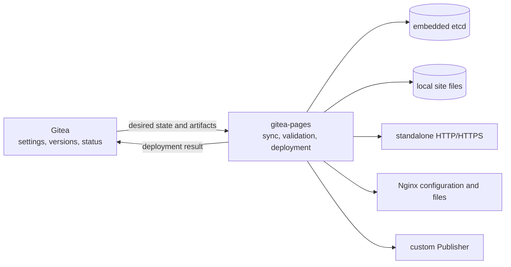

# Gitea Pages

Gitea Pages publishes static websites managed by [Gitea](https://github.com/go-gitea/gitea). Gitea owns repository settings, publication sources, content versions, instance registration, and deployment status. A `gitea-pages` instance synchronizes the desired state, validates and deploys the current `tar.gz` artifact, serves it locally, and reports the result to Gitea.

Pages can serve traffic directly with Go's HTTP server, generate and activate configuration for an external Nginx process, or run as a Go library behind a custom web front end.

> [!IMPORTANT]
> Every website published by the current service is public. Repository visibility and website access are separate settings.

## Highlights

- GitHub-style project URLs at `https://<owner>.<pages-domain>/<repository>/`.
- Owner sites at `https://<owner>.<pages-domain>/` from a repository named `.pages`.
- Branch/directory, Actions artifact, and web/API artifact publication through Gitea.
- Full synchronization on first start followed by cursor-based incremental updates.
- Locally deployed content on the request path, so visitors do not depend on Gitea availability.
- Standalone HTTP/HTTPS serving and external Nginx integration.
- Custom domains with optional Gitea and Pages TXT ownership checks.
- Operator certificates and ACME automation through [`go-acme/lego`](https://github.com/go-acme/lego).
- HTTP-01 for custom domains and DNS-01 for the default Pages domain.
- Embedded single-member etcd with no externally exposed client or peer listener.
- Safe `tar.gz` validation and extraction with synchronized resource limits.
- A reusable `gitea.dev/page` package and `Publisher` interface for custom web servers.
- Custom platform home page, 404 page, assets, and Nginx templates.

## How it works



Gitea remains the control plane and artifact source. Each Pages instance independently deploys every enabled site and keeps its own local state. Instances do not form an etcd cluster and Gitea does not assign repositories to individual instances.

## Requirements

- Go 1.27 or later when building from source.
- A Gitea installation containing the matching Pages integration.
- A Pages instance token created by a Gitea site administrator.
- A persistent local filesystem for state and deployed content.
- DNS for the Pages root domain and its wildcard subdomains.
- Nginx 1.19.4 or later when using `nginx` mode.
- A certificate source when the Pages root URL uses HTTPS.

## Installation

Clone the repository and build the executable:

```sh
git clone https://github.com/ExplodingDragon/gitea-pages.git
cd gitea-pages
make build
./bin/gitea-pages --help
```

The binary is written to `bin/gitea-pages`. The project does not require a separately managed etcd service.

## Quick start

The following example starts a standalone HTTP instance behind a local reverse proxy.

1. Point `pages.example.com` and `*.pages.example.com` to the reverse proxy, preserve the request Host, and route HTTP traffic to `127.0.0.1:3000`.
2. Open Gitea site administration, create a Pages instance, and copy the one-time instance token.
3. Create a persistent data directory and start the service:

```sh
export GITEA_PAGES_GITEA_URL=https://gitea.example.com
export GITEA_PAGES_ROOT_URL=http://pages.example.com
export GITEA_PAGES_TOKEN='replace-with-the-instance-token'
export GITEA_PAGES_DATA_ROOT="$HOME/.local/share/gitea-pages"
export GITEA_PAGES_HTTP_LISTEN=127.0.0.1:3000

install -d -m 0700 "$GITEA_PAGES_DATA_ROOT"

./bin/gitea-pages standalone
```

After the instance appears as connected in Gitea, enable Pages in a repository, choose `Branch` or `Actions or upload`, and publish content. The first synchronization loads all enabled sites; later synchronizations request entries changed after the cursor returned by Gitea.

Use a service manager to inject the environment, restart the process, and retain `GITEA_PAGES_DATA_ROOT` across upgrades.

## Publishing model

Gitea accepts content from a configured branch and directory, an Actions deployment, or a web/API upload. All sources produce the same `tar.gz` artifact and version history. Pages instances download only the current version selected by Gitea.

A valid artifact contains at least one regular file. An `index.html` file is useful for a conventional website but is not required: without one, the directory URL returns 404 while contained files remain available by path.

Gitea and Pages both validate the archive. Pages verifies the digest again while downloading, extracts into a temporary directory, validates the resulting filesystem, removes executable permission bits from regular files, and publishes the candidate only after the selected serving mode confirms it. A failed candidate leaves the previous confirmed site active.

## Serving modes

| Mode | Command | Visitor entry point | Operational behavior |
| --- | --- | --- | --- |
| Standalone | `gitea-pages standalone` | Built-in Go HTTP/HTTPS server | Pages owns listeners, routing, TLS, and content responses. |
| Nginx | `gitea-pages nginx` | Operator-managed Nginx | Pages writes content and configuration, runs test and reload commands, and probes the active virtual host. Nginx can continue serving the last confirmed deployment while Pages restarts. |

### Standalone

Standalone mode needs an HTTP listener. An HTTPS root URL also needs a separate HTTPS listener:

```sh
export GITEA_PAGES_HTTP_LISTEN=:80
export GITEA_PAGES_HTTPS_LISTEN=:443

./bin/gitea-pages standalone
```

The HTTP listener serves HTTP-01 challenges. For an HTTPS instance, known website hosts redirect ordinary HTTP requests to HTTPS.

### Nginx

Nginx mode writes a managed `pages.conf` include fragment, platform assets, route markers, configuration snapshots, and exported certificates below `GITEA_PAGES_NGINX_ROOT`. The include fragment belongs in the Nginx `http` context.

Pages tests a candidate before replacing the confirmed configuration. The test command receives the candidate path through `{candidate}`; an operator wrapper can place that fragment into a complete Nginx configuration:

```sh
export GITEA_PAGES_NGINX_ROOT=/var/lib/gitea-pages-nginx
export GITEA_PAGES_NGINX_HTTP_PROBE_ADDR=127.0.0.1:80
export GITEA_PAGES_NGINX_TEST_COMMAND='["/usr/local/libexec/gitea-pages-nginx-test","{candidate}"]'
export GITEA_PAGES_NGINX_RELOAD_COMMAND='["nginx","-s","reload"]'

./bin/gitea-pages nginx
```

For HTTPS, also set `GITEA_PAGES_NGINX_HTTP01_ROOT` and `GITEA_PAGES_NGINX_HTTPS_PROBE_ADDR`. The Nginx worker needs read and traverse access to `sites/` and `route-state/` below `GITEA_PAGES_DATA_ROOT`; the embedded etcd directory remains private to the Pages process.

## Configuration

The command reads configuration from `GITEA_PAGES_` environment variables. URLs use standard HTTP or HTTPS ports, and managed directory paths are absolute. Pages checks that writable roots do not overlap because each root has a separate cleanup and permission boundary.

### Common settings

| Variable | Required | Default | Description |
| --- | --- | --- | --- |
| `GITEA_PAGES_GITEA_URL` | Yes | — | Gitea HTTP or HTTPS root URL, without a path. |
| `GITEA_PAGES_ROOT_URL` | Yes | — | Public Pages root URL, without a path or explicit port. |
| `GITEA_PAGES_TOKEN` | Yes | — | Instance token created in Gitea administration. |
| `GITEA_PAGES_DATA_ROOT` | Yes | — | Persistent root for embedded etcd, site content, work files, and route state. |
| `GITEA_PAGES_SYNC_INTERVAL` | No | `1m` | Incremental synchronization interval; minimum `1m`. |
| `GITEA_PAGES_DEPLOY_TIMEOUT` | No | `10m` | Maximum time for one deployment operation. |
| `GITEA_PAGES_DEPLOY_QUEUE_SIZE` | No | `32` | Maximum number of queued repository deployments. |
| `GITEA_PAGES_DEPLOY_CONCURRENCY` | No | `2` | Number of deployments processed concurrently. |
| `GITEA_PAGES_ETCD_QUOTA_BYTES` | No | `2147483648` | Embedded etcd backend quota; minimum 64 MiB. |
| `GITEA_PAGES_DNS_RESOLVER` | No | System resolver | Recursive DNS server for local ownership TXT checks, as an IP address with an optional port. |
| `GITEA_PAGES_DNS_REFRESH_INTERVAL` | No | `15m` | Ownership TXT cache and refresh interval; allowed range `1m` to `24h`. |
| `GITEA_PAGES_CUSTOM_ROOT` | No | — | Existing root containing custom platform resources and Nginx templates. |

### Serving mode settings

| Variable | Standalone | Nginx | Description |
| --- | --- | --- | --- |
| `GITEA_PAGES_HTTP_LISTEN` | Required | — | HTTP listen address and standalone HTTP-01 entry point. |
| `GITEA_PAGES_HTTPS_LISTEN` | HTTPS | — | Standalone HTTPS listen address. |
| `GITEA_PAGES_NGINX_ROOT` | — | Required | Nginx output root. |
| `GITEA_PAGES_NGINX_HTTP01_ROOT` | — | HTTPS | Directory exposed by Nginx for HTTP-01 challenge files. |
| `GITEA_PAGES_NGINX_HTTP_PROBE_ADDR` | — | Required | Local IP and port used to probe the HTTP virtual host. |
| `GITEA_PAGES_NGINX_HTTPS_PROBE_ADDR` | — | HTTPS | Local IP and port used to probe the HTTPS virtual host. |
| `GITEA_PAGES_NGINX_TEST_COMMAND` | — | Required | JSON string array containing `{candidate}` exactly once. |
| `GITEA_PAGES_NGINX_RELOAD_COMMAND` | — | Required | JSON string array that reloads the confirmed Nginx configuration. |
| `GITEA_PAGES_NGINX_COMMAND_TIMEOUT` | — | `30s` | Timeout for Nginx test and reload commands. |

### HTTPS and ACME settings

An HTTPS deployment needs either an operator-provided default certificate or an ACME directory with a DNS-01 provider for the default Pages domain. Automated custom-domain certificates use HTTP-01.

| Variable | Required | Default | Description |
| --- | --- | --- | --- |
| `GITEA_PAGES_CERT_ROOT` | Certificate dependent | — | Operator certificate input root, separate from other managed roots. |
| `GITEA_PAGES_ACME_DIRECTORY_URL` | To enable ACME | — | ACME directory endpoint. |
| `GITEA_PAGES_ACME_EMAIL` | With ACME | — | ACME account contact email. |
| `GITEA_PAGES_ACME_EAB_KID` | With EAB | — | External Account Binding key identifier. |
| `GITEA_PAGES_ACME_EAB_HMAC_KEY` | With EAB | — | Base64url-encoded EAB HMAC key. |
| `GITEA_PAGES_HTTP01_PROBE_ADDRESSES` | Custom-domain ACME | — | Comma-separated `IP:port` addresses checked before a custom-domain ACME order. |
| `GITEA_PAGES_DNS_PROVIDER` | Default-domain DNS-01 | — | DNS-01 adapter name; currently `command`. |
| `GITEA_PAGES_ACME_DNS_RESOLVER` | No | Ownership resolver | Recursive DNS server used by lego for zone discovery and propagation checks. |
| `GITEA_PAGES_DNS_PRESENT_COMMAND` | Command provider | — | JSON string array containing `{name}` and `{value}` exactly once. |
| `GITEA_PAGES_DNS_CLEANUP_COMMAND` | Command provider | — | JSON string array containing `{name}` and `{value}` exactly once. |

The command DNS provider keeps provider-specific credentials outside Pages. The service manager supplies those credentials to the configured commands; lego continues to own ACME account and order handling.

When several Pages instances serve the same custom domain, the HTTP entry point must route each `/.well-known/acme-challenge/` request to the instance currently performing the order. If it reaches another instance, the preflight or CA validation fails and that instance keeps the custom address unpublished until a later retry.

## Operator certificates

The default certificate uses these paths:

```text
<GITEA_PAGES_CERT_ROOT>/default/fullchain.pem
<GITEA_PAGES_CERT_ROOT>/default/privkey.pem
```

A custom-domain certificate uses the SHA-256 digest of its lowercase host as the directory name:

```text
<GITEA_PAGES_CERT_ROOT>/hosts/<sha256>/host
<GITEA_PAGES_CERT_ROOT>/hosts/<sha256>/fullchain.pem
<GITEA_PAGES_CERT_ROOT>/hosts/<sha256>/privkey.pem
```

The `host` file contains the lowercase domain name. Pages validates certificate names, validity, and key pairs before use. Nginx mode exports accepted certificates below `<GITEA_PAGES_NGINX_ROOT>/certs`.

## Custom platform resources

`GITEA_PAGES_CUSTOM_ROOT` can replace the bundled Pages landing page, error page, assets, and Nginx templates:

```text
public/index.html
public/errors/404.html
public/assets/
nginx/pages.conf.tmpl
nginx/server.inc
nginx/location.inc
```

Files not supplied by the custom root continue to use their bundled versions. Platform resources remain separate from repository website content so an operator can change service-wide presentation without modifying published artifacts.

## Use as a Go package

The root package exposes the synchronization service and the publication boundary while keeping protocol, storage, etcd, certificate, and ACME records internal.

```go
import page "gitea.dev/page"

service, err := page.NewService(cfg, publisher,
	page.WithLogger(logger),
	page.WithHTTPClient(httpClient),
)
if err != nil {
	return err
}
defer service.Close()

return service.Run(ctx)
```

Implement `page.Publisher` to connect another web server:

```go
type Publisher interface {
	Restore(context.Context, Deployments) error
	Publish(context.Context, Deployment) (Publication, error)
	Unpublish(context.Context, int64) error
}
```

`Restore` receives an iterator over confirmed local deployments. `Publish` receives the repository ID, public addresses, and immutable validated content. `Content.Open` satisfies `fs.FS`, while `Content.Path` exposes the extracted directory for servers that require a filesystem path.

Calls for one repository are serialized; different repositories may be published concurrently. A publisher that returns an error from `Publish` restores the previous route before returning. The content remains valid until a later `Publish` or `Unpublish` for the same repository succeeds.

The service continues to own Gitea registration, synchronization, download and digest checks, archive validation, extraction, TXT ownership checks, and result reporting. The custom publisher owns its HTTP/TLS lifecycle and confirms which addresses are active.

## Operations and recovery

- Keep `GITEA_PAGES_DATA_ROOT` on persistent local storage and use it from one Pages process at a time.
- Embedded etcd stores synchronization state, deployment facts, certificate material, and pending reports without binding a public port.
- Normal restarts restore confirmed routes from local state before processing new updates.
- When Gitea is unavailable, confirmed sites keep serving and deployment reports remain pending locally.
- Nginx keeps using the last successfully loaded configuration and site files when the Pages process is stopped.
- To rebuild a damaged local state, stop the process, clear its data root, and restart it. An empty state performs a full synchronization and redeploys every enabled site.

Archive limits and the custom-domain ownership requirement come from Gitea during synchronization. A changed limit applies the next time content is deployed; it does not rewrite an already confirmed site.

## Security

Publication artifacts are untrusted input. Gitea validates each upload before storage, and Pages validates it again during extraction. The checks cover compressed input bounds, expanded size, entry count, path length and depth, absolute and traversal paths, duplicate normalized names, unsafe entry types, link resolution, extraction timeout, and final filesystem contents.

Relative symbolic links are accepted when their resolved path remains inside the site directory, including links whose target is absent from the artifact. Absolute links, escaping links, hard links, devices, sockets, and other special entries fail the deployment. Regular files are published without executable permission bits.

Custom-domain ownership can be enforced independently by Gitea and each Pages instance. After a successful TXT check, an existing route receives a 24-hour grace period for later mismatches or resolver failures. A new domain becomes eligible only after its first successful check. Pages also verifies local HTTP-01 reachability before creating an ACME order, which reduces avoidable CA rate-limit failures.

ACME account keys, certificate private keys, DNS command credentials, extracted content, and embedded etcd state remain on the Pages host. Protect the data, certificate, and command environment with operating-system permissions appropriate for the service account.

## Development

Run the complete local verification before submitting a change:

```sh
make format
make tidy
make check
make build
```

`make check` verifies formatting, runs `go vet`, executes the complete test suite, and builds every package.

The repository layout keeps the reusable API separate from runtime details:

```text
page.go                     Public `gitea.dev/page` API
cmd/main.go                 Process entry point and signal context
cmd/root.go                 Cobra root command
cmd/standalone/             Standalone process lifecycle
cmd/nginx/                  Nginx process assembly
internal/runtime/           Synchronization, storage, validation, TLS, and publishers
internal/runtime/resources/ Bundled platform pages and assets
```

Issues and pull requests should include the behavior being changed and the verification used to confirm it.

## License

Gitea Pages is licensed under the [MIT License](LICENSE).
